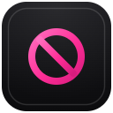
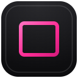
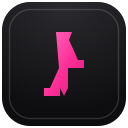
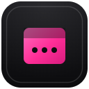

# Riah Extensions

## Direct answer

**Riah Extensions** is a public set of small browser extensions from Riah Studio for Chrome, Edge, Brave, and Firefox. Each extension does one job (autoplay guard, paste restore, YouTube controls, and similar), uses minimal permissions, and ships without telemetry or remote config. Limitations: not every extension ships on every browser when the browser already covers that job natively.

Browser extensions are awesome, but sometimes they get sold. The new owner can change what the code does while you keep the same install. [Pieter Levels](https://levels.io/open-sourced-chrome-extension-superlevels) has been loud about that risk, and he is right.

These are small extensions I actually use. You can load them if you want. The better use is to point your agent at this repo and rebuild your own versions from the source. I do not expect you to run my exact set.

Each one does one job. Minimal permissions. No telemetry. No remote scripts. No remote config. Pink Riah icons so you can tell them apart on the toolbar.

<p>











</p>

## What I use them for

| | Extension | What it does |
| --- | --- | --- |
|  | **Autoplay Guard** | Blocks unwanted media autoplay outside YouTube. |
|  | **Cookie Quiet** | Dismisses or rejects cookie consent banners. |
|  | **Library Search** | Opens a configured library or catalog search from book pages. |
|  | **Paste Guard** | Restores paste where sites try to block it. |
|  | **Right Click Restorer** | Restores right-click, copy, selection, and image drag. |
|  | **Tab Anchor** | Puts accidentally detached tabs back where they belong. |
|  | **Tab Sleeper** | Discards idle tabs on a timer (Firefox). |
|  | **Tenhou English** | English labels on Tenhou. |
|  | **Thai Year Helper** | Gregorian year next to Thai Buddhist Era years. |
|  | **Timeline Exporter** | Exports visible X posts to a local CSV. |
|  | **Volume Boost** | Boosts or mutes the current tab. |
|  | **YouTube Controls** | Opens watch pages and Shorts paused. Keeps autoplay and captions where you want them. |
|  | **YouTube Quality** | Caps YouTube quality at your preferred ceiling. |

Slug folders live under `extension-source/shared/<slug>/`.

## Point an agent at this repo

That is the main point of publishing these.

1. Clone the repo, or open it in Cursor / Claude Code / Codex / whatever you use.
2. Ask the agent to rebuild one extension for your browser, with your rules.
3. Keep the readable one-job shape. Change the behavior until it is yours.
4. Load the unpacked build yourself and read the source before you trust it.

You can also install these as-is. Treat that as a starting point, not a brand loyalty program.

## Brave first

I live on these in **Brave**. That is the tested path.

Chrome and Firefox packages are in the tree because Chromium packages share a build, and Firefox has its own manifests where they make sense. I have not finished loading and testing those browsers myself yet, so this repo is not a Chrome Web Store or Firefox Add-ons launch claim.

If you want them on Chrome or Firefox, fork the source and verify there before you depend on them.

## Load in Brave (unpacked)

1. Build:

```powershell
npm test
npm run build
```

2. Open `brave://extensions`, turn on Developer mode, Load unpacked.
3. Point at folders under `extension-source/dist/chrome/` (Tab Sleeper is Firefox-only).

Or double-click `Start All Riah Extensions in Brave.bat` for a disposable Brave profile.

## Why they are split up

One extension per job is easier to audit, easier for an agent to copy, and easier to delete when the browser finally ships the feature itself.

Already retired when native tools took over: site zoom, default zoom, page translate, selection translate.

Some tools only ship where the browser is missing them. Cookie Quiet is for Chromium browsers without a solid native banner blocker. Tab Sleeper is Firefox-only. Volume Boost needs Chromium tabCapture.

## Docs

- `PRIVACY.md`
- `SECURITY.md`
- `SUPPORT.md`
- `docs/PUBLISHING.md`
- `docs/brand/` for the pink icon system

## Buy me a coffee

These are free. If they helped, you can [buy me a coffee](https://buymeacoffee.com/riahstudio).

## Credit

Pieter Levels wrote about extensions getting bought by spyware and malware outfits, and about open-sourcing tools you can audit or customize with AI. Start here: [levels.io/open-sourced-chrome-extension-superlevels](https://levels.io/open-sourced-chrome-extension-superlevels). This repo is my version of that idea: small readable sources you can steal from on purpose.

